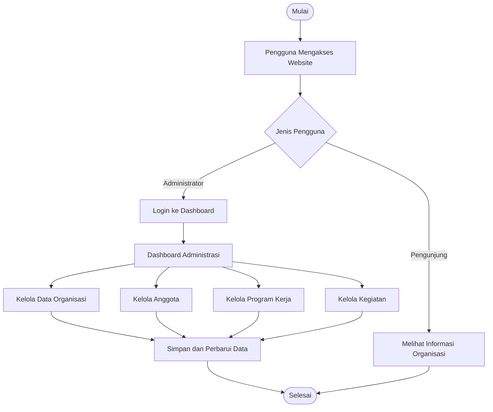

# SMO — Sistem Manajemen Organisasi

<p align="center">
  
  
  
</p>

<h3 align="center">Digital Organization Management Platform</h3>

<p align="center">
  Platform digital untuk membantu pengelolaan organisasi sekolah secara modern, terstruktur, transparan, dan terintegrasi.
</p>

<p align="center">
  <a href="https://smo.web.id/">Live Website</a> •
  <a href="#tentang-proyek">Tentang Proyek</a> •
  <a href="#fitur-utama">Fitur</a> •
  <a href="#dokumentasi-aplikasi">Dokumentasi</a>
</p>

---

## 📖 Tentang Proyek

**SMO (Sistem Manajemen Organisasi)** merupakan aplikasi berbasis web yang dirancang untuk mendukung digitalisasi pengelolaan organisasi sekolah, khususnya Organisasi Siswa Intra Sekolah (OSIS) dan Majelis Perwakilan Kelas (MPK).

SMO hadir sebagai solusi untuk membantu organisasi sekolah dalam mengelola berbagai aspek administrasi dan operasional melalui satu platform digital. Sistem ini dirancang untuk mengurangi ketergantungan terhadap pencatatan manual, mempermudah koordinasi antaranggota, serta meningkatkan transparansi dalam pelaksanaan kegiatan organisasi.

Melalui SMO, berbagai informasi organisasi dapat dikelola secara lebih sistematis, mulai dari struktur kepengurusan, program kerja, kegiatan, hingga dokumentasi dan pelaporan organisasi.

Platform ini mengedepankan pengalaman pengguna yang intuitif dengan antarmuka modern sehingga dapat digunakan oleh pengurus organisasi maupun pihak yang membutuhkan informasi terkait aktivitas organisasi.

### 🌐 Live Application

**Website:** https://smo.web.id/

---

## 🎯 Latar Belakang

Dalam menjalankan organisasi sekolah, terdapat berbagai aktivitas administratif yang membutuhkan pengelolaan secara terstruktur. Mulai dari pendataan anggota, penyusunan program kerja, koordinasi kegiatan, hingga dokumentasi hasil pelaksanaan program.

Pengelolaan yang masih dilakukan secara manual dapat menimbulkan beberapa kendala, seperti:

- Informasi organisasi yang tersebar di berbagai media.
- Kesulitan dalam memantau perkembangan program kerja.
- Dokumentasi kegiatan yang tidak terorganisasi.
- Koordinasi antaranggota yang kurang efisien.
- Kesulitan dalam melakukan evaluasi dan pelaporan kegiatan.
- Kurangnya transparansi terhadap aktivitas organisasi.

Oleh karena itu, SMO dikembangkan sebagai platform digital yang bertujuan untuk mengintegrasikan proses pengelolaan organisasi sekolah ke dalam satu sistem yang lebih efisien.

## 💡 Tujuan Pengembangan

1. **Digitalisasi Administrasi**  
   Mengubah proses administrasi organisasi menjadi sistem digital yang lebih terstruktur.

2. **Efisiensi Pengelolaan**  
   Mempermudah pengurus dalam mengelola data, informasi, dan aktivitas organisasi.

3. **Transparansi Organisasi**  
   Meningkatkan keterbukaan informasi mengenai program kerja dan kegiatan organisasi.

4. **Optimalisasi Koordinasi**  
   Mendukung koordinasi dan kolaborasi antaranggota organisasi.

5. **Dokumentasi Terpusat**  
   Menyediakan pengelolaan dokumentasi dan informasi organisasi secara lebih sistematis.

6. **Evaluasi Program Kerja**  
   Membantu pemantauan dan evaluasi pelaksanaan program kerja organisasi.

---

## ✨ Fitur Utama

SMO dirancang dengan beberapa modul utama untuk mendukung kebutuhan pengelolaan organisasi sekolah.

### 1. Manajemen Organisasi

Pengelolaan informasi dasar organisasi yang mencakup:

- Informasi profil organisasi.
- Identitas dan periode kepengurusan.
- Struktur organisasi.
- Informasi kepengurusan.
- Pembagian jabatan dan tanggung jawab.

### 2. Manajemen Anggota

Pengelolaan data anggota organisasi untuk membantu administrasi kepengurusan.

- Pendataan anggota.
- Informasi identitas anggota.
- Jabatan dan posisi dalam organisasi.
- Pengelompokan anggota berdasarkan bidang.
- Pengelolaan informasi kepengurusan.

### 3. Manajemen Program Kerja

Pengelolaan program kerja sebagai bagian penting dari aktivitas organisasi.

- Pendataan program kerja.
- Informasi dan deskripsi kegiatan.
- Penanggung jawab program.
- Perencanaan pelaksanaan program.
- Pemantauan status program kerja.
- Dokumentasi hasil pelaksanaan.

### 4. Manajemen Kegiatan

Pengelolaan aktivitas dan agenda organisasi agar kegiatan dapat terorganisasi dengan baik.

- Pendataan kegiatan organisasi.
- Informasi jadwal kegiatan.
- Lokasi dan deskripsi kegiatan.
- Status pelaksanaan kegiatan.
- Dokumentasi kegiatan.

### 5. Transparansi Informasi

Penyajian informasi organisasi yang dapat membantu warga sekolah mengetahui aktivitas dan perkembangan organisasi.

- Informasi organisasi.
- Program kerja.
- Kegiatan organisasi.
- Dokumentasi aktivitas.
- Informasi terkait kepengurusan.

### 6. Dashboard Administrasi

Dashboard sebagai pusat informasi dan pengelolaan organisasi.

- Ringkasan informasi organisasi.
- Statistik data organisasi.
- Informasi program kerja.
- Ringkasan aktivitas.
- Akses ke modul pengelolaan.

### 7. Dokumentasi dan Pelaporan

Pengelolaan dokumentasi untuk mendukung kebutuhan administrasi dan evaluasi organisasi.

- Penyimpanan dokumentasi kegiatan.
- Pengelompokan informasi kegiatan.
- Riwayat pelaksanaan program.
- Dokumentasi hasil kegiatan.

*Catatan: Daftar modul di atas merupakan gambaran ruang lingkup sistem. Ketersediaan setiap fitur mengikuti implementasi aktual aplikasi.*

---

## 👥 Pengguna Sistem

Sistem manajemen organisasi dapat melibatkan beberapa jenis pengguna dengan kebutuhan dan tanggung jawab berbeda.

| Pengguna | Peran |
|---|---|
| Administrator | Mengelola sistem dan data organisasi |
| Pengurus OSIS | Mengelola program kerja dan kegiatan OSIS |
| Pengurus MPK | Mendukung pengelolaan dan pengawasan organisasi |
| Anggota | Mengakses informasi organisasi sesuai hak akses |
| Siswa | Melihat informasi dan aktivitas organisasi |
| Pembina | Memantau aktivitas organisasi sesuai kewenangan |

---

## 🖥️ Dokumentasi Aplikasi

Bagian ini digunakan untuk menampilkan dokumentasi visual dari halaman-halaman aplikasi SMO.

### 1. Landing Page

Halaman utama yang menjadi pintu masuk pengguna untuk mengenal sistem dan informasi organisasi.


### 2. Dashboard Admin

Halaman utama administrator untuk memantau informasi dan mengelola aktivitas organisasi.


### 3. Manajemen Organisasi

Halaman untuk mengelola kepengurusan, dan struktur organisasi.


### 5. Manajemen Kegiatan

Halaman untuk mengelola agenda dan dokumentasi kegiatan organisasi.


---

## 🧩 Arsitektur Sistem

Secara umum, aplikasi SMO menggunakan konsep aplikasi web yang terdiri dari beberapa bagian utama:

```text
SMO — Sistem Manajemen Organisasi
│
├── User Interface
│   ├── Landing Page
│   ├── Informasi Organisasi
│   ├── Program Kerja
│   └── Kegiatan
│
├── Administration
│   ├── Dashboard
│   ├── Manajemen Anggota
│   ├── Manajemen Organisasi
│   ├── Manajemen Program Kerja
│   └── Manajemen Kegiatan
│
└── Data Management
    ├── Organization Data
    ├── Member Data
    ├── Work Program Data
    └── Activity Data
```

---

## 🛠️ Teknologi Pengembangan

Teknologi yang digunakan dalam proyek ini mengikuti implementasi aktual pada repository.

| Komponen | Teknologi |
|---|---|
| Frontend | Sesuaikan dengan source code |
| Backend | Sesuaikan dengan source code |
| Database | Sesuaikan dengan konfigurasi |
| Deployment | Web Hosting / Domain |
| Version Control | Git & GitHub |

---

## 🚀 Instalasi dan Menjalankan Proyek

Untuk menjalankan SMO secara lokal, ikuti langkah berikut.

### 1. Clone Repository

```bash
git clone https://github.com/USERNAME/REPOSITORY.git
```

### 2. Masuk ke Direktori Proyek

```bash
cd REPOSITORY
```

### 3. Install Dependencies

Gunakan package manager yang sesuai dengan teknologi proyek.

```bash
npm install
```

### 4. Konfigurasi Environment

Buat file `.env` berdasarkan konfigurasi yang dibutuhkan aplikasi.

```env
# Sesuaikan dengan konfigurasi proyek
```

### 5. Jalankan Development Server

Jika proyek menggunakan npm script `dev`:

```bash
npm run dev
```

### 6. Buka Aplikasi

Akses alamat lokal yang ditampilkan oleh development server, biasanya:

```text
http://localhost:3000
```
## 🔐 Keamanan dan Pengelolaan Data

Pengembangan sistem manajemen organisasi perlu memperhatikan beberapa aspek penting:

- Pengelolaan hak akses pengguna.
- Perlindungan informasi anggota organisasi.
- Validasi data sebelum disimpan.
- Pengelolaan autentikasi dan sesi pengguna.
- Keamanan konfigurasi environment.
- Pengelolaan dokumentasi dan file yang diunggah.

---

## 📌 Manfaat Proyek

| Aspek | Manfaat |
|---|---|
| Administrasi | Pengelolaan data lebih terstruktur |
| Organisasi | Mempermudah koordinasi pengurus |
| Program Kerja | Memudahkan pemantauan kegiatan |
| Transparansi | Informasi organisasi lebih mudah diakses |
| Dokumentasi | Penyimpanan informasi lebih sistematis |
| Evaluasi | Mendukung pemantauan dan evaluasi kegiatan |

---

## 🗺️ Alur Penggunaan Sistem



---

## 🤝 Kontribusi

Kontribusi dan saran pengembangan sangat terbuka untuk membantu meningkatkan kualitas proyek SMO.

Jika ingin berkontribusi:

1. Fork repository ini.
2. Buat branch baru untuk perubahan.
3. Lakukan pengembangan atau perbaikan.
4. Commit perubahan dengan deskripsi yang jelas.
5. Buat Pull Request.

---

## 📄 Lisensi

Lisensi proyek mengikuti ketentuan yang ditetapkan oleh pemilik repository.

---

## 👨‍💻 Developer

**SMO — Sistem Manajemen Organisasi**

Dikembangkan sebagai platform digital untuk mendukung pengelolaan organisasi sekolah yang lebih modern, efektif, dan transparan.

🌐 Website: https://smo.web.id/

---

<p align="center">
  <strong>SMO — Empowering Student Organizations Through Technology.</strong>
